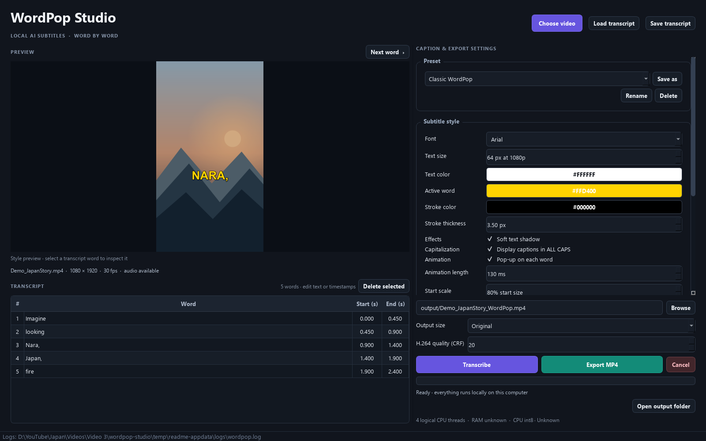

# WordPop Studio

**Local, editable, word-by-word animated subtitles for short-form video.**

WordPop Studio is a Windows desktop app that transcribes speech on your computer, lets you correct the transcript, and burns animated captions into a new MP4. Your source video and audio stay local. The first setup and first model download need internet access; transcription and rendering use local tools afterward.

<p align="center">
  
</p>

<p align="center">
  
</p>

The screenshots use demo transcript text and a simple generated background; they contain no user video footage.

## What it does

- Transcribes video audio locally with faster-whisper and requests word-level timestamps.
- Detects the spoken language automatically or lets you select English or Hindi. Automatic multilingual transcription can handle English/Hindi code-switching when the selected model recognizes it.
- Shows each active word in sync with its timestamp. Optional phrase mode displays only words already spoken and highlights the current word.
- Lets you review and correct words and start/end times before export. Transcripts can be saved as JSON and loaded again.
- Renders a real text outline, optional shadow, and a restrained pop-up animation into the exported frames.
- Exports a self-contained H.264 MP4 with FFmpeg. The output does not need a separate subtitle file or player plugin.

## Appearance and presets

The default **Classic WordPop** preset displays one word at a time, with white text, a bright yellow active word (`#FFD400`), a black 3.5 px outline at 1080p reference size, and a 130 ms ease-out pop animation. The outline is a text stroke, not a caption box.

The settings panel lets you adjust font, size, text and active colors, outline color and thickness, shadow, animation, safe margins, vertical position, and display mode. The **Display captions in ALL CAPS** switch changes rendered caption text while keeping the editable transcript’s capitalization intact. Settings can be saved for future runs.

Built-in presets:

- **Clean White** — white caption text with an outline.
- **Yellow Pop** — white words with a yellow active word.
- **Classic WordPop** — single active word, yellow highlight, outline, and pop animation. This is the default.
- **Phrase Highlight** — a short growing phrase with the current word highlighted.

Custom presets can be saved, renamed, and deleted from the preset controls.

## Requirements

- Windows 10 or 11, 64-bit. The project has been tested on Windows x64.
- CPython 3.14 and the Python launcher (`py`).
- FFmpeg and FFprobe on `PATH`. The FFmpeg build must include the `subtitles` filter with libass support.
- Internet access for installing Python dependencies and downloading a Whisper model the first time it is needed.

An NVIDIA GPU with a compatible CUDA/CTranslate2 setup can be used when detected and configured. Otherwise the app uses CPU int8 inference. The app does not claim GPU acceleration unless it has successfully selected the GPU path. On the 8 GB reference machine, the default `base` model is a practical starting point.

## Install

1. Install Python 3.14 for Windows and ensure the Python launcher is available. In PowerShell, check:

   ```powershell
   py -3.14 --version
   ```

2. Install an FFmpeg Windows build and add its `bin` directory to `PATH`. Open a new terminal and check:

   ```powershell
   ffmpeg -version
   ffprobe -version
   ffmpeg -filters | findstr subtitles
   ```

   If the last command shows a `subtitles` filter, the build includes the filter WordPop needs. Official FFmpeg downloads are listed at [ffmpeg.org/download.html](https://ffmpeg.org/download.html).

3. Open the `wordpop-studio` folder and double-click **setup.bat**. It creates a project-local `.venv` and installs the pinned packages there; it does not install Python packages globally.

4. Double-click **run.bat** to launch WordPop Studio.

To launch from PowerShell in the project folder:

```powershell
.\.venv\Scripts\python.exe main.py
```

You can pass a video path on launch as well:

```powershell
.\.venv\Scripts\python.exe main.py "D:\Videos\my-video.mp4"
```

The first transcription downloads the selected model to the local cache. Approximate model sizes are shown in the UI: `tiny` ~75 MB, `base` ~145 MB, `small` ~484 MB, `medium` ~1.5 GB, and `large-v3` ~3.1 GB. Smaller models use less disk and usually transcribe faster. Cached models are reused.

## Make a subtitled video

1. **Choose a video.** Click **Choose video** or drag a file into the window. MP4, MOV, MKV, and WebM are supported when the installed FFmpeg build can decode their streams. The app shows duration, dimensions, frame rate, and audio availability, then loads the full video into the preview player.
2. **Choose the transcription options.** Keep automatic language detection, or select English or Hindi. Leave the model at `base` for the recommended balance on a modest computer; choose a smaller or larger model as needed.
3. **Click Transcribe.** Progress appears in the window while the worker runs in the background. The detected language, word count, and inference device are reported when it finishes.
4. **Review the transcript before exporting.** Check names, places, punctuation, and timing. See [Correct transcript errors](#correct-transcript-errors) below.
5. **Preview and choose the caption style.** Use **Play/Pause** and the seek bar to watch the full video with audio and synchronized captions. Captions follow the transcript's word timings and selected style, including capitalization, active-word color, outline, and pop animation. Select a transcript row to jump to that word; **Next word** also seeks through the transcript. Turn on **Display captions in ALL CAPS** when desired.
6. **Choose export settings.** The default is the source dimensions, H.264 MP4, and CRF 20. `Original` keeps the source resolution and aspect ratio; other choices scale to a selected output height. The source frame rate is preserved where practical.
7. **Click Export MP4.** A progress bar reports rendering status. The app asks before replacing an existing file. Click **Open output folder** after completion to find the result.

The source video is never overwritten. FFmpeg creates the final video in one render pass, keeps compatible source audio or encodes it as AAC, and verifies the output has a video stream and retains audio when present. If the source has no audio, the app exports the video without an audio stream.

## Correct transcript errors

Always make corrections before **Export MP4**. The transcript table has columns for the word, start time, and end time, with times in seconds.

1. Select a transcript row to seek the video preview to that word's start time.
2. Double-click the **Word**, **Start (s)**, or **End (s)** cell you want to change and type the correction.
3. Use **Delete selected** to remove unwanted recognized words.
4. Play from the corrected word or select nearby rows to check the timing in the full video preview. Start times must be nonnegative, end times must be later than start times, and the times must fit within the video.
5. Click **Save transcript** to keep your corrections in a reusable `.wordpop.json` file.
6. Export the MP4 again to burn the corrected text and timings into the video.

WordPop Studio auto-saves a new transcript as `output/<video-name>.wordpop.json`. When you reopen that same video, the matching transcript is loaded when available. Use **Load transcript** to choose a saved JSON file manually. **Transcribe** runs speech recognition again and replaces the transcript currently in the editor.

The table supports correcting or deleting recognized rows; it does not provide a full timeline editor or an add-word control. For substantially missing speech, re-run transcription with another model and review the result before export.

## Output, settings, and logs

- **Rendered MP4s:** `output/<video-name>_WordPop.mp4` by default. The output path can be changed with **Browse**.
- **Reusable transcripts:** `output/<video-name>.wordpop.json` by default. Transcript JSON contains word text, start/end seconds, detected language, and timing labels.
- **Temporary render data:** `temp/`. Temporary subtitle scripts and partial render files are cleaned up after completion or cancellation.
- **User preferences and custom presets:** `%LOCALAPPDATA%\WordPop Studio\WordPop Studio\` (exact Windows path may vary by Qt version).
- **Whisper model cache:** `%LOCALAPPDATA%\WordPop Studio\WordPop Studio\models\`.
- **Logs:** the `logs` folder in the app’s local data directory.

The `.gitignore` excludes virtual environments, caches, logs, temporary data, and generated files in `output/`. Generated videos and transcripts are intentionally kept out of source control by default.

## Troubleshooting

**FFmpeg or FFprobe is not found**

Install FFmpeg, add its `bin` folder to `PATH`, close and reopen PowerShell, then verify `ffmpeg -version` and `ffprobe -version`.

**The `subtitles` filter is missing**

Install an FFmpeg build with libass/subtitles support. Verify with `ffmpeg -filters | findstr subtitles`.

**A model download fails**

Check internet access and free disk space, then try again. Models are cached locally after download. The default model is about 145 MB.

**Transcription is slow**

Use `tiny` or `base`, close other heavy applications, or configure a compatible NVIDIA CUDA environment. Integrated graphics and non-NVIDIA GPUs are not used for faster-whisper CUDA acceleration.

**A word or timestamp is wrong**

Correct it in the transcript table and save the transcript before rendering. Model transcripts can make mistakes, especially with names and places, so review them before publishing.

**A font looks different in the exported file**

Select an installed font in the font picker. If the requested font is unavailable, the app falls back to an installed sans-serif font.

**Export fails or is cancelled**

Read the message in the app and check the log. Ensure the output disk has enough free space and the MP4 is not locked by another application. A cancelled or failed render leaves the source video untouched.

## Project layout

```text
wordpop-studio/
├── assets/                 # README screenshots
├── config/presets.json     # Built-in caption presets
├── output/                 # Generated MP4s and transcript JSON (ignored)
├── temp/                   # Temporary render data (ignored)
├── tests/                  # Automated component and render tests
├── tools/                  # README screenshot capture helper
├── wordpop/
│   ├── services/           # Transcription, timing, subtitles, FFmpeg export
│   ├── ui/                 # PySide6 window, preview, settings, transcript editor
│   └── utils/               # Configuration, FFmpeg, logging, system information
├── main.py
├── requirements.txt
├── setup.bat
└── run.bat
```

## Development

Activate the local environment or call its Python directly, then run the test suite:

```powershell
.\.venv\Scripts\python.exe -m pytest -q
```

The suite covers timestamp parsing and boundaries, caption placement, animation progress, font fallback, preset loading, transcript persistence, output naming, error handling, and a short FFmpeg render smoke test.

To regenerate the README screenshots on Windows:

```powershell
$env:QT_QPA_PLATFORM = "offscreen"
.\.venv\Scripts\python.exe tools\capture_readme_screenshots.py
```

## Privacy and third-party components

Video/audio transcription and video rendering run locally. Internet is used during setup and when a Whisper model is not cached yet; media files are not sent to a transcription service.

WordPop Studio code and documentation are licensed under the MIT License; see [LICENSE](LICENSE). Third-party Python packages, FFmpeg, fonts, and downloaded Whisper model weights retain their own licenses and terms. This project does not bundle the model weights or grant rights to user-supplied video, audio, or fonts.

## License

MIT. See [LICENSE](LICENSE).
